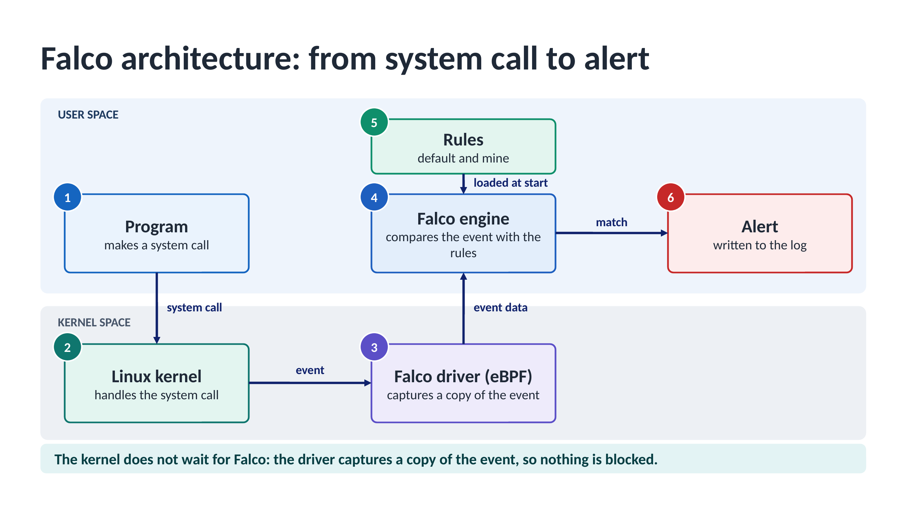
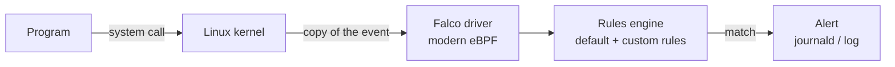
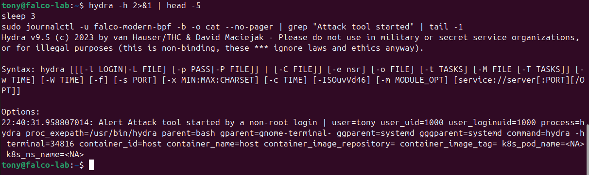
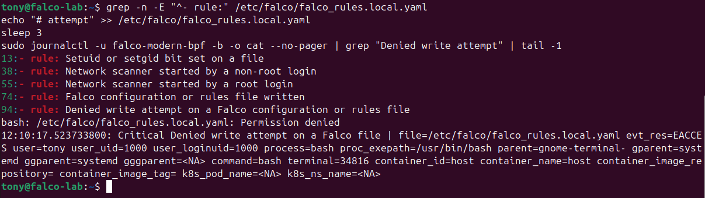
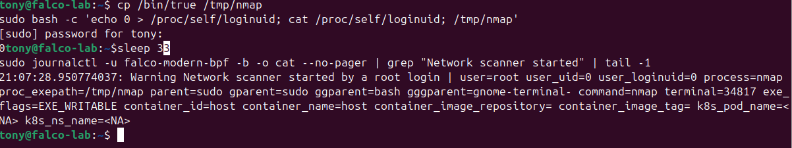

<div align="center">

# Falco Runtime Security

### Custom detection rules for a Linux host, tested on a live Ubuntu VM and tuned until the noise was gone




</div>

> Custom [Falco](https://falco.org) rules that detect suspicious behaviour on a Linux host: privilege escalation, reconnaissance, and attacks on the monitoring itself. Every rule was tested with a deliberate trigger, its noise was measured in normal use, and its limits are documented.

**Context:** midterm project for *Administration Unix*, Master in Systems and Networks (Information Security option), Saint Joseph University of Beirut (USJ). Supervised by Prof. Fadi Chebli, October 2026.

---

## Table of contents

- [Highlights](#highlights)
- [How Falco works](#how-falco-works)
- [The rules](#the-rules)
- [Tuning: removing false alerts without losing detection](#tuning-removing-false-alerts-without-losing-detection)
- [Screenshots](#screenshots)
- [Live demo: eleven scenes](#live-demo-eleven-scenes)
- [Repository structure](#repository-structure)
- [Lab environment](#lab-environment)
- [How to try it](#how-to-try-it)
- [Known limits](#known-limits)
- [Documentation](#documentation)
- [Disclaimer](#disclaimer)
- [Author](#author)

---

## Highlights

| | |
|---|---|
| **9 custom rules** | seven rule families (A to D) written for attacks that matter on a Linux host, each mapped to MITRE ATT&CK where a technique applies |
| **3 default rules reviewed** | *Read sensitive file untrusted*, *Run shell untrusted*, *Execution from /dev/shm*, and how noisy they are on a real desktop |
| **3 rules tuned** | narrow exceptions, each followed by a check that the real detection still works |
| **11 demo scenes** | one harmless trigger per rule, run live from a single script |
| **73-page report** | method, every test with its output, noise measurements and limits |

**Key result:** the default rule *Read sensitive file untrusted* produced **27 false alerts** in a controlled boot-and-login comparison (51 in the whole log), all caused by the GNOME login manager. After a narrow exception it produced **0 alerts**, and a deliberate `cat /etc/shadow` still raised the alert.

## How Falco works

Falco watches the **system calls** that programs make to the Linux kernel and compares each one with a set of rules. When a rule matches, Falco writes an alert.



Falco is a **detection** tool (an IDS): it works on a copy of the event, so the alert comes **after** the action, and it never blocks anything.

## The rules

| Rule | Detects | Level | MITRE ATT&CK |
|---|---|---|---|
| **A** Setuid or setgid bit set on a file | A planted privileged backdoor (`chmod u+s`) | WARNING | T1548.001 |
| **B** Network scanner started (non-root login) | Reconnaissance with `nmap`, `masscan`, `nc` and similar | CRITICAL | T1046 |
| **B** Network scanner started (root login) | Same tools, started by an account that logged in as root | WARNING | T1046 |
| **C1** Denied write attempt on a Falco file | Someone without rights tries to change Falco's rules | CRITICAL | T1562.001 |
| **C2** Falco configuration or rules file written | Rules or configuration edited | WARNING | T1562.001 |
| **C3** Falco file renamed or deleted | Rules replaced or removed without a write | WARNING | T1562.001 |
| **C4** Falco service stopped or disabled | `systemctl stop/disable/mask/kill falco` | ALERT | T1562.001 |
| **D** Attack tool started (non-root login) | `john`, `hashcat`, `hydra`, `medusa`, `ncrack`, `msfconsole`, `msfvenom`, `sqlmap` | ALERT | none |
| **D** Attack tool started (root login) | Same tools, started by an account that logged in as root | CRITICAL | none |

The three **default rules** reviewed are *Read sensitive file untrusted*, *Run shell untrusted* and *Execution from /dev/shm*.

**Design ideas**

- The level of rules **B** and **D** depends on `user.loginuid` (the account that originally logged in), not on the current user, because `sudo` keeps the login id. A scanner started with `sudo` by a normal login is still treated as a normal login.
- Rules **C1** and **C2** depend on the **outcome** of the write: a refused write is more suspicious than a successful one.

## Tuning: removing false alerts without losing detection

A rule that fires all the time gets ignored. Three rules were tuned with narrow exceptions, and after each one the real detection was tested again.

| # | Rule | Exception | Check |
|---|---|---|---|
| 1 | *Read sensitive file untrusted* (default) | the login manager (`gdm-session-worker`, and `pkexec` started by `update-notifier`) | verified with `dpkg -S` and `dpkg -V`; 27 false alerts down to 0; `cat /etc/shadow` still alerts |
| 2 | **A** | package-manager changes to files under system folders | the limit of this exception is documented |
| 3 | **C2** | the swap file that `nano` creates next to a file it edits | only the `.swp` file of `nano` is excluded |

## Screenshots

| Attack tool (rule D) | Denied write (rule C1) | Scanner, root login (rule B) |
|---|---|---|
|  |  |  |

## Live demo: eleven scenes

`demo/falco_demo.sh` runs one harmless trigger per rule. Press Enter to go to the next scene.

| # | Scene | Expected result |
|---|---|---|
| 1 | Default rule 1: read the password file | WARNING, sensitive file opened by a non-trusted program |
| 2 | Rule A: the setuid bit, then a silent control | WARNING for the setuid bit; no alert when the bit is removed |
| 3 | Rule B: a scanner, as me and with `sudo` (stand-in named `nmap`) | CRITICAL both times (the login id is still mine, not 0) |
| 4 | Rule C1: a normal user tries to write in the Falco folder | "Permission denied", CRITICAL alert |
| 5 | Rules C2 and C3: write, then delete, in the Falco folder | WARNING for the write, then WARNING for the delete |
| 6 | Rule C4: try to disable Falco (stand-in named `systemctl`) | ALERT, the highest level (Falco keeps running) |
| 7 | Rule D: a real attack tool (`hydra`, help only) | ALERT (nothing is attacked) |
| 8 | Rule B, lower level: a simulated root login | WARNING (lower), because the login id is 0 |
| 9 | Rule D: a stand-in named `john` | alert for an attack tool |
| 10 | Default rule 2: a shell under a fake web server | NOTICE, shell spawned by an untrusted binary |
| 11 | Default rule 3: a program run from `/dev/shm` | WARNING, file execution detected from `/dev/shm` |

## Repository structure

```
falco-runtime-security/
├── rules/falco_rules.local.yaml   # the custom rules and the tuning exceptions
├── demo/falco_demo.sh             # live demo: one harmless trigger per rule
├── docs/Falco_Midterm_Report.pdf  # full report (73 pages)
├── docs/Falco_Presentation.pdf    # presentation slides
└── images/                        # architecture diagram and alert screenshots
```

## Lab environment

- Falco **0.45.0**, **modern eBPF** driver (service `falco-modern-bpf`)
- Ubuntu **24.04 LTS** Desktop, in a VirtualBox virtual machine
- Rules loaded after the default `falco_rules.yaml`, from `/etc/falco/falco_rules.local.yaml`

## How to try it

> Use a **disposable virtual machine**. The demo only uses harmless stand-ins (copies of `/bin/true`) and test files, but it touches `/etc/falco/`.

1. Install Falco with the modern eBPF driver on an Ubuntu VM.
2. Copy the rules file and restart Falco:
   ```bash
   sudo cp rules/falco_rules.local.yaml /etc/falco/falco_rules.local.yaml
   sudo systemctl restart falco-modern-bpf
   ```
3. In one terminal, follow the alerts:
   ```bash
   sudo journalctl -u falco-modern-bpf -f -o cat --no-pager
   ```
4. In a second terminal, run the demo as a normal user (not root):
   ```bash
   bash demo/falco_demo.sh          # all scenes
   bash demo/falco_demo.sh 4        # start at scene 4
   DRYRUN=1 bash demo/falco_demo.sh # print the commands only
   ```

## Known limits

Good detection also means knowing what a rule cannot do:

- Rules cannot **count** (for example, "ten failed logins in a minute").
- A process running as root can rewrite its own login id, so the `loginuid` split is a convention and not a guarantee.
- An administrator and an attacker look the same when both use `sudo`.
- Tools that are **renamed or copied** under another name, and interpreters running attack code, can avoid name-based rules.
- Paths containing `..` can slip past a rule that tests where a path starts (documented for rule A).
- Falco **detects only**. To stop an attack it must be combined with other controls.

## Documentation

The full method, every test with its output, the noise measurements and the limits are in [`docs/Falco_Midterm_Report.pdf`](docs/Falco_Midterm_Report.pdf). The slides are in [`docs/Falco_Presentation.pdf`](docs/Falco_Presentation.pdf).

## Disclaimer

This project is educational. The attack tools named in the rules are only used as **names to detect**, and every test ran on my own virtual machine. Do not run attack tools on systems you do not own or have permission to test.

## Author

**Tony Doumit** · [LinkedIn](https://linkedin.com/in/tony-doumit) · [GitHub](https://github.com/Doumit04)
